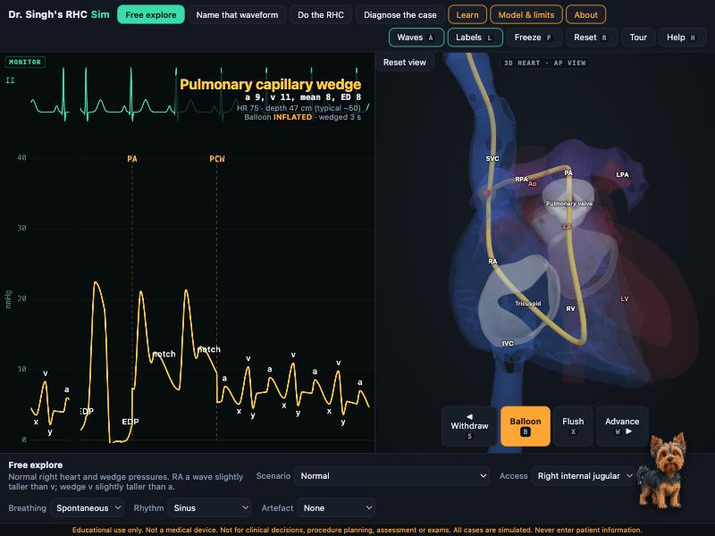

# Dr. Singh's RHC Sim

An open, browser-based **right heart catheterization waveform simulator** for students, residents and fellows.
Float a balloon-tipped catheter through a transparent 3D heart (SVC or IVC → RA → tricuspid valve → RV →
pulmonary valve → PA → wedge) and watch the pressure trace change beside it, beat by beat, against the ECG.

[](https://doi.org/10.5281/zenodo.23743411)

**Live:** https://dradityaaiims-cloud.github.io/rhc-sim/

> Educational use only. Not a medical device. Not for clinical decisions, procedure planning, assessment or exams. All cases are simulated. Never enter patient information.



## Run it

```bash
npm install
npm run dev      # http://localhost:5173
npm test         # node --test tests/*.test.js
npm run build    # static site in dist/ (relative base, works on GitHub Pages)
```

## Controls

W / S (or ↑ / ↓) advance and withdraw (Shift = fine), B balloon, X flush, Enter record, F freeze, A wave labels,
L 3D labels, R reset, M cycle mode, H help. The Advance, Withdraw and Balloon buttons work with mouse and touch.

## Modes

- **Free explore**: any of eleven scenarios (normal, severe TR, severe MR, mitral stenosis, pre-capillary PH,
  isolated post-capillary PH, RV infarction, tamponade, constriction, atrial fibrillation, hypovolaemia), from the
  right internal jugular or femoral vein, with spontaneous or ventilator breathing, sinus or AF rhythm, and optional
  artefacts (catheter whip, over- or underdamping). Bad wedges (under- and over-wedge) and coiling are modelled.
- **Name that waveform**: catheter and diagnosis hidden; name the site from the trace.
- **Do the RHC**: record RA, RV, PA and PCW; get TPG, DPG, PVR, the 2022 ESC/ERS PH classification and a score.
- **Diagnose the case**: the same on an unknown patient, then pick the diagnosis.

Plus a Learn tab, a guided tour, Boba the rule-based assistant dog, and Model & limits and About pages.

## Layout

| Path | What |
|---|---|
| `src/sim/hemo.js` | Waveform engine: ECG-timed keypoints per site and scenario, periodic monotone cubic, respiration, readings, calculations |
| `src/sim/catheter.js` | Catheter path, balloon, valve crossing, wedge zones, coiling |
| `src/sim/artifacts.js` | Catheter whip, over- and underdamping, as filters on the true pressure |
| `src/modes/` | Modes; `scoring.js` is pure and tested |
| `src/render/` | `monitor.js` (canvas sweep) and `heart3d.js` (three.js) only draw |
| `src/learn/`, `src/pages/`, `src/ui/` | Learn content, Model & limits, About, Boba, tour |
| `src/pages/config.js` | Version, DOI, contact and feedback link |
| `tests/` | `node --test` unit tests for the waveforms, catheter, scoring, Boba and content |

## Sources and limitations

Scenario values follow the author's research specification (RHC best-practice reviews, Contemporary PAC Part 1,
2022 ESC/ERS guidelines); they are illustrative, unvalidated teaching values. Waveforms are drawn from ECG-timed
keypoints, not from a mechanical model. See the in-app **Model & limits** page for details and the full list of
limitations (no LV trace, no saturations or shunts, simplified artefacts).

## Deploy

Every push to `main` runs the tests, builds and deploys to GitHub Pages (`.github/workflows/pages.yml`).

## Cite

See [CITATION.cff](CITATION.cff) or the About page (APA and BibTeX). DOI: [10.5281/zenodo.23743411](https://doi.org/10.5281/zenodo.23743411).

## 3D anatomy

The heart and great vessels are derived from the NIH Human Reference Atlas (HuBMAP) 3D Reference Organs, Heart,
Blood Vasculature and Lung, Male v1.2 (Visible Human Male, U.S. National Library of Medicine), **CC BY 4.0**, https://humanatlas.io.
See [public/models/ATTRIBUTION.md](public/models/ATTRIBUTION.md) for the changes made. To rebuild the model, put the two
source GLBs in `tools/hra-src/` and run `node tools/build-heart.mjs`.

## Licence

MIT for the code. See [LICENSE](LICENSE). The 3D model in `public/models` is CC BY 4.0 (see above).
